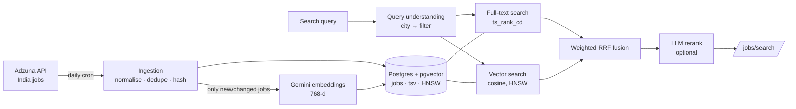
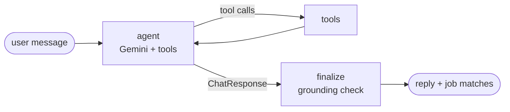

# JobPilot

An AI job-matching agent for the Indian tech job market. JobPilot keeps a live index of real
job postings, searches it with hybrid semantic + keyword retrieval and an LLM reranker, and
gives you a chat agent that uses tools, remembers your skills and preferences across
conversations, and explains why each job fits, recommending only jobs that really exist.


## Status

| Part | State |
|---|---|
| Jobs index: daily ingestion from Adzuna, change detection, expiry | ✅ Working (900+ live jobs, growing daily) |
| Hybrid search API with filters and city aliases | ✅ Working |
| Retrieval evals (P@10, MRR, nDCG@10) | ✅ Working, results below |
| LLM reranker (Gemini) | ✅ Working, best eval score |
| Chat agent with tools, memory and grounded answers (`/chat`) | ✅ Working |
| Resume upload → structured profile (no personal details stored) | ✅ Working |
| Personalised ranking (profile + saved/liked/disliked jobs) | ✅ Working |
| Personalisation eval and agent eval (checks + LLM judge) | ✅ Working, results below |
| Web app: chat, job cards, resume upload, saved jobs, 👍/👎, history | ✅ Working (React + Vite) |
| CI: lint, backend tests with Postgres+pgvector, frontend tests + build | ✅ `.github/workflows/ci.yml` |
| Deployment (Render blueprint + Neon) | ✅ Ready to deploy, see [Deploy](#deploy). Live link: *add after deploy* |

## How it works



### Ingestion (`backend/app/ingest/`)
- Pulls jobs from the [Adzuna](https://www.adzuna.in) API for 14 tech searches (software, data,
  ML/AI, cloud, mobile, internships…), or loads a CSV (including Kaggle's LinkedIn postings format).
- Cleans HTML, detects remote jobs, keeps only salaries the employer actually posted, and removes
  jobs that appear under several searches.
- **Incremental:** each job gets a SHA-256 hash of its content. Only new or changed jobs are
  embedded; unchanged jobs just get `last_seen_at` updated. A re-run over the same jobs embeds 0.
- **Expiry:** jobs not seen for 7 days, or posted more than 60 days ago, become inactive.
- **Built for free-tier limits:** Gemini allows 100 embeddings/minute and 1,000/day. The loader
  paces itself, embeds the newest jobs first, stops cleanly at the daily cap and resumes on the
  next run. Each run embeds at most 800 jobs so some quota is left for live searches.
- A GitHub Actions workflow (`.github/workflows/ingest.yml`) runs it every day at 07:00 IST.

### Search (`backend/app/search/`)
- **Keyword:** Postgres full-text search on a generated `tsvector` (title weighted above company
  and description). Terms are OR-ed and search filler words ("jobs", "role"…) are dropped.
- **Dense:** cosine similarity on Gemini `gemini-embedding-001` vectors, HNSW index, with
  pgvector 0.8 iterative scans so filtered searches still return enough rows.
- **Hybrid:** weighted Reciprocal Rank Fusion of the two top-50 lists.
- **Query understanding:** a city named in the query ("…in Gurugram") becomes a location filter
  that also matches its other spellings (Gurugram/Gurgaon, Bengaluru/Bangalore…).
- **Filters:** location, remote only, remote-OK, minimum salary, posted within N days.
- **Duplicates:** reposts of the same job (same title, company, location) are collapsed.
- **Rerank (optional):** one structured-output LLM call scores the top 20 hybrid results 0–10.
- Query embeddings are cached in Postgres, so repeated searches cost no embedding quota.
- **Graceful degradation:** if query embeddings are unavailable (e.g. daily quota), search falls
  back to keyword-only instead of failing, so `/chat` keeps working.

### Web app (`frontend/`)

React 18 + Vite, no UI framework, about 50 KB of JS gzipped. The design is deliberately plain:
one reading column, text-only controls, neutral colours, no icons or badges.

- **Conversation** in a single centred column; results appear as a simple list under the reply.
- **Each job:** title (links to the posting), company · city · remote · salary in LPA · posted
  date, fit score out of 10, why it fits, and skills worth brushing up on.
- **Actions under each job:** Save, More like this, Not interested (hidden from future searches,
  including reposts), Apply.
- **Profile drawer:** resume upload, what JobPilot knows (roles, skills, cities), saved jobs.
- **History drawer:** past searches reopen with their results.
- **Accounts:** none. An anonymous id is kept in `localStorage`.
- **Errors:** plain messages for 429 (slow down), 503 (model busy) and network errors.
- Works at phone width; light and dark themes follow the system setting.

### Personalisation (`backend/app/search/personalize.py`, `backend/app/profile.py`)
- **User vector (Rocchio):** `u = 1.0·profile + 0.75·mean(saved or liked jobs) − 0.25·mean(disliked jobs)`,
  normalised. The profile embedding is built from target roles, skills, experience and summary
  (not locations: those are filters, not meaning).
- **Reorder, don't retrieve:** the user vector ranks only the query's own candidates, and that
  ranking joins RRF as a third list. A Python developer searching "frontend React" still gets
  frontend jobs, just the ones closest to their profile.
- **Dislikes are hidden** from later searches. Saving a job counts as liking it.
- **Resume upload:** the PDF is read in memory (never saved), checked (PDF magic bytes, 5 MB, has
  text), and turned into a `ResumeProfile` by one structured-output call. Only job-relevant fields
  are stored: no name, email or phone.
- If the embedding API is down when a profile changes, the profile is still saved and its vector
  is filled in lazily on a later search.

### Agent (`backend/app/agent/`)

A small LangGraph state machine instead of a black-box agent:



- **Tools:** `search_jobs` (hybrid search with filters, personalised for the user), `get_job`,
  `save_job`, `rate_job` (like / not interested), `list_saved_jobs`, `update_profile`.
- **Structured answers:** the model must call a tool every step (`tool_choice="any"`). Its final
  answer is a call to a `ChatResponse` schema (reply + `JobMatch` list with `fit_score`,
  `why_it_fits`, `missing_skills`), so the output is validated without a second LLM call.
- **Grounding in code, not just in the prompt:** `finalize` keeps only jobs that a tool actually
  returned in this conversation, and copies title and company from the tool data. An invented
  job id can never reach the user; dropped ids are logged and returned as `dropped_job_ids`.
- **Memory:** conversation state is checkpointed in Postgres (`langgraph-checkpoint-postgres`,
  thread = conversation). Long histories are trimmed to the most recent turns.
- **Long-term profile:** skills, target roles, cities, salary and experience are stored in the
  `profiles` table via `update_profile`, and loaded into the system prompt on every turn, so a new
  conversation already knows the user.
- **Safety by design:** the user id comes from the request config, never from the model, so tools
  can't touch another user's data. References like "save the second one" resolve against the
  last list shown; if there is no such item, the agent asks instead of guessing.
- **Resilience:** Gemini often returns 503 under load. Calls are rate-limited, retried, and fall
  back through a list of models; if all are busy, `/chat` returns a clean 503 with `Retry-After`.
- **Abuse protection:** per-IP sliding-window limits (chat 30 per 10 min, search 30/min, resume
  5/hour) keep one client from draining the free-tier quota. They return 429 with `Retry-After`.

Example conversation (live run):

> **User:** I'm a final-year CS student. I know Python, FastAPI and SQL and I want a backend
> internship in Bengaluru.
> *(agent calls `update_profile`, `search_jobs`, `get_job`)*
> **JobPilot:** Here are the best backend opportunities in Bengaluru matching your profile:
> 1. Software Engineering Intern (Server/Backend), Nudge: fit 10
> 2. Python Developer, VY Systems: fit 7, missing Django, Flask
>
> **User:** Save the second one. *(calls `save_job` 634)* Saved.
>
> **User:** Save the tenth one too. → "You only have 2 matches in your recent list…"

## Evaluation

`evals/retrieval_eval.py` runs 32 golden queries against the live index and compares the search
modes. Relevance is labelled by rules (regexes on title, location, company, remote) instead of
fixed job IDs, so the labels stay valid as the index changes every day.

Latest run, 900 active jobs, k = 10 (full table: [`evals/results/retrieval_latest.md`](evals/results/retrieval_latest.md)):

| Mode | P@10 | MRR | nDCG@10 |
|---|---|---|---|
| keyword | 0.553 | 0.783 | 0.616 |
| dense | 0.703 | 0.984 | 0.807 |
| hybrid (keyword weight 0.5) | 0.700 | 0.928 | 0.788 |
| **hybrid + LLM rerank** | **0.769** | **0.964** | **0.872** |

What I learned from it:
- **City aliases and filler-word removal** raised every mode (keyword nDCG 0.55 → 0.62, hybrid
  0.73 → 0.78). Before the fix, "software jobs in Gurugram" scored 0.00 with keyword search,
  because the postings say "Gurgaon".
- **Dense beats keyword clearly** on plain-language queries such as "engineer who builds web user
  interfaces" (0.76 vs 0.07).
- **Hybrid is close to dense, not above it.** Adzuna descriptions are short (~500 characters), so
  keyword ranking is noisy. Lowering the keyword weight in RRF helps a little (0.777 → 0.788).
  Hybrid stays the default because the eval labels judge only titles, so they can't measure where
  keyword search helps most: exact terms like a company name, "Kafka" or "FastAPI" in the description.
- **The LLM reranker is the clear winner** (nDCG 0.79 → 0.87). It fixes exactly the cases
  where fusion struggled: "software developer jobs in Gurugram" 0.72 → 1.00, "engineer who builds
  web user interfaces" 0.58 → 0.93. It costs one extra LLM call per search, so the API exposes it
  as `mode=hybrid_rerank`; the agent uses plain hybrid search and does its own judging.
- **Limitation:** rule labels by title are strict. A relevant job with an unusual title counts as a
  miss for every mode, so absolute numbers are pessimistic; the comparison between modes is the
  useful part.

### Personalisation eval

`evals/personalization_eval.py` creates 8 temporary personas (data engineer, Java backend,
frontend, ML, student, QA, DevOps, full stack) and runs vague queries ("software engineer",
"developer jobs in Bengaluru", "engineering jobs") with and without the persona, at several
personal weights. Relevance = the persona's role (+ city). Results go to
`evals/results/personalization_latest.md`.

24 persona × query cases, k=10:

| Ranking | nDCG@10 | P@10 |
|---|---|---|
| No personalisation | 0.041 | 0.050 |
| Personal weight 0.5 | 0.091 | 0.092 |
| **Personal weight 1.0 (default)** | **0.131** | **0.138** |
| Personal weight 2.0 | 0.179 | 0.179 |
| Personal weight 4.0 | 0.269 | 0.267 |

The profile triples nDCG@10 on vague queries at the default weight. Absolute numbers are low
because the queries are deliberately vague and relevance is a strict title rule. The score keeps
rising with the weight because this eval only rewards matching the persona; it never penalises
ignoring what the user typed. So the weight is set to 1.0, equal to the dense list: the profile can
tie the query's own ranking but not outvote it. Choosing beyond that needs an eval of specific
queries with a profile attached (on the roadmap).

### Agent eval

`evals/agent_eval.py` runs 10 scripted conversations against the live agent: backend internship
in Bengaluru, data engineering in Hyderabad, Java in Pune, remote-only, "save the first one",
"save the 15th one", "tell me more about the first one", an off-topic request, memory across two
conversations, and "not interested in the first one, show me others". Each turn is checked for:

- **tool accuracy:** expected tools called, forbidden tools not called
- **match quality:** at least 60% of matches fit the requested role / city / remote
- **ordinals and dislikes:** the right job saved; the disliked job gone from the next results
- **grounding:** no invented job ids
- **LLM judge (1–5):** relevance and faithfulness of the `why_it_fits` explanations, judged by a
  different model from the agent's to limit self-preference

Full run (10 scenarios, 15 turns, `gemini-3.5-flash-lite`, judge on a different model):

| Metric | Value |
|---|---|
| Tool accuracy | 100% |
| Checks passed | 95.7% (100% excluding provider errors) |
| Turns passed | 13 / 15 |
| Judge relevance / faithfulness (1–5) | 4.8 / 4.3 |
| Latency median / max | 11.3 s / 24.8 s |

Both failed turns were Gemini `503 UNAVAILABLE` on every fallback model, not agent mistakes.
Rerunning those two scenarios passed every check (including "not interested in the first one":
`rate_job` then a new search without that job). The lowest faithfulness scores (3/5) were on
explanations that claimed more about a job than its short Adzuna description says.

## API

| Method | Path | Description |
|---|---|---|
| GET | `/health` | DB status and active job count |
| GET | `/jobs/search?q=…` | Search. Params: `location`, `remote`, `remote_ok`, `min_salary`, `posted_within_days`, `limit` (≤50), `mode` = `keyword` \| `dense` \| `hybrid` \| `hybrid_rerank`, `user_id` (personalise) |
| GET | `/jobs/{id}` | Full job posting |
| POST | `/chat` | `{user_id, conversation_id?, message}` → `{conversation_id, reply, matches[], tools_used[], dropped_job_ids[]}` |
| GET | `/users/{user_id}/conversations` | The user's conversations |
| GET | `/users/{user_id}/conversations/{id}/messages` | Chat history with matches |
| GET | `/users/{user_id}/saved` | Saved jobs |
| POST | `/users/{user_id}/saved` | Save a job `{job_id}` |
| DELETE | `/users/{user_id}/saved/{job_id}` | Unsave |
| POST | `/users/{user_id}/resume` | Upload a resume PDF (multipart `file`) → parsed + stored profile |
| GET | `/users/{user_id}/profile` | The stored profile |
| POST | `/feedback` | `{user_id, job_id, rating: 1 \| -1}`: like / not interested |

Users are anonymous: the client generates a `user_id` (UUID) and keeps it. There is no login
yet, so anyone who knows a user id can read that user's data. Fine for a demo, not for production.

Example:

```
GET /jobs/search?q=python backend internship in Bengaluru&limit=5
```

Each result includes `score`, `dense_rank`, `keyword_rank` and `personal_rank`, so you can see why it ranked where it did.

## Database

Postgres with pgvector (`backend/app/db/schema.sql`, applied on startup):

- `jobs`: postings, with an embedding (HNSW index), generated `tsv` (GIN index), `content_hash`,
  `is_active`, `first_seen_at`/`last_seen_at`
- `query_cache`: cached query embeddings
- `users`, `profiles` (long-term memory), `conversations`, `messages` (history with matches and
  tools used), `saved_jobs`, `feedback`
- LangGraph checkpoint tables (`checkpoints`, …): agent conversation state
- `eval_runs`: every eval run with its config and metrics

## Tech stack

FastAPI · Postgres 16+ with pgvector (Neon in development) · psycopg 3 · Gemini
(`gemini-3.5-flash-lite` chat with fallbacks, `gemini-embedding-001` embeddings) ·
LangGraph + langgraph-checkpoint-postgres · LangChain core · Adzuna API ·
pytest · ruff · uv · Docker · GitHub Actions

## Run it locally

Requirements: [uv](https://docs.astral.sh/uv/), and a Postgres database with pgvector
(a free [Neon](https://neon.tech) project, or `docker compose up db`).

```bash
uv sync
cp .env.example .env      # then fill in DATABASE_URL, GOOGLE_API_KEY, ADZUNA_APP_ID/KEY

cd backend
../.venv/bin/python -m app.ingest.pipeline adzuna --pages 5     # load jobs (Windows: ..\.venv\Scripts\python)
../.venv/bin/uvicorn app.main:app --reload                       # API on http://localhost:8000/docs
```

Frontend (in another terminal):

```bash
cd frontend
npm install
npm run dev          # http://localhost:3000, talks to VITE_API_URL (default http://localhost:8000)
```

Or run the database and API together with Docker: `docker compose up --build`.

Other commands:

```bash
.venv/bin/python evals/retrieval_eval.py         # retrieval eval (saves to eval_runs + evals/results/)
.venv/bin/python evals/personalization_eval.py   # personalisation eval (temporary personas)
.venv/bin/python evals/agent_eval.py             # agent eval: scripted chats + LLM judge
.venv/bin/pytest                                  # unit tests
TEST_DATABASE_URL=<postgres url> .venv/bin/pytest # + DB tests (only touch rows with source='pytest')
.venv/bin/ruff check backend tests evals scripts
.venv/bin/python scripts/usage_report.py --days 30  # users, chats, feedback, latest evals
cd frontend && npm test && npm run build
```

Ingestion CLI options: `--query` (repeatable), `--pages`, `--max-days-old`, `--max-embed`,
`--stale-days`, `--dry-run`; or `csv <path> --source <name>`.

## Deploy

The repo has a [Render](https://render.com) blueprint (`render.yaml`) for the API (Docker) and
the web app (static site). The database stays on Neon. Both Render services fit the free plan.

1. Push the repo to GitHub.
2. In Render: **New → Blueprint**, then pick the repo. It creates `jobpilot-api` and `jobpilot-web`.
3. When asked, set `DATABASE_URL` (Neon connection string) and `GOOGLE_API_KEY`.
4. If Render assigns different URLs than `jobpilot-api.onrender.com` / `jobpilot-web.onrender.com`,
   update `CORS_ORIGINS` (API) and `VITE_API_URL` (web) to match, then redeploy the web app.
5. Check `https://<api>/health`, then open the web app.
6. Add the GitHub secrets for the daily job refresh (`DATABASE_URL`, `GOOGLE_API_KEY`,
   `ADZUNA_APP_ID`, `ADZUNA_APP_KEY`).

Free-plan note: Render puts idle free services to sleep, so the first request after a while takes
about a minute. The rate limits are in-memory, which is right for one instance; with several
instances they'd move to Postgres or Redis.

## Project structure

```
backend/app/
  main.py              FastAPI app (shared resources built once at startup)
  config.py            settings from environment / .env
  profile.py           profile merge, profile embedding
  resume/parse.py      resume PDF → structured profile
  embeddings.py        Gemini embeddings with pacing, retries, daily-quota handling
  llm.py               Gemini chat model: rate limit, retries, fallback models
  agent/               graph.py (LangGraph), tools.py, prompts.py, schemas.py, service.py
  db/                  schema.sql, connection pool
  ingest/              adzuna.py, csv_source.py, normalize.py, pipeline.py (CLI)
  search/              hybrid.py, rerank.py, personalize.py, locations.py, metrics.py, models.py
  routers/             health.py, jobs.py, chat.py, profile.py
  ratelimit.py         per-IP sliding-window limits
evals/                 retrieval_eval.py + golden_queries.jsonl, personalization_eval.py + personas.jsonl,
                       agent_eval.py + agent_scenarios.jsonl, results/
tests/                 API, unit (agent with a scripted fake model) and DB integration tests
frontend/              React + Vite app: src/App.jsx, components/, api.js, lib/ (+ vitest)
scripts/               usage_report.py
.github/workflows/     ci.yml (lint + tests + build), ingest.yml (daily job refresh)
render.yaml            deploy blueprint (API + web app)
```

## Roadmap

1. **Eval specific queries with a profile attached**, to tune the personal weight against
   query relevance (the current eval only uses vague queries).
2. **Deploy and share** with 10–20 job seekers; track usage with `scripts/usage_report.py`.
3. **Next ideas:** streaming replies, login instead of anonymous ids, summarising long chats,
   a learned ranker trained on 👍/👎 and saves once there is enough feedback.

---

Jobs data by [Adzuna](https://www.adzuna.in).
